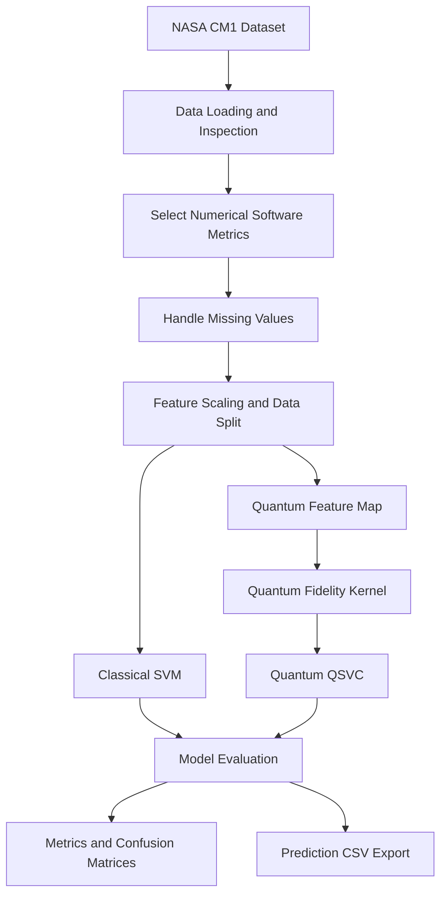

# TrioByte

**VTU-QFF-HC-0036** | Tier: **Offline**

---

| Detail | Information |
|:---|:---|
| **Team Name** | TrioByte |
| **Team ID** | VTU-QFF-HC-0036 |
| **Tier** | Offline |
| **Event** | VTU-QFF Hackathon — VTU-Qiskit Fall Fest 2026 |
| **Project Title** | Quantum ML-Based Software Bug Prediction |
| **Repository** | [vtu-hc-triobyte](https://github.com/vtu-qiskit-fall-fest-2026/vtu-hc-triobyte) |
| **Organisation** | [vtu-qiskit-fall-fest-2026](https://github.com/vtu-qiskit-fall-fest-2026) |

---

## 📌 Table of Contents

- [Team Members](#-team-members)
- [Problem Statement](#-problem-statement)
- [Proposed Solution](#-proposed-solution)
- [Approach and Architecture](#-approach-and-architecture)
- [Dataset](#-dataset)
- [Tech Stack](#-tech-stack)
- [Project Structure](#-project-structure)
- [How to Run](#-how-to-run)
- [Experimental Results](#-experimental-results)
- [Limitations](#-limitations)
- [Future Improvements](#-future-improvements)
- [Submission Checklist](#-submission-checklist)
- [Resources](#-resources)
- [License](#-license)

---

## 👥 Team Members

| # | Name | GitHub Profile | Role |
|:---:|:---|:---|:---|
| 1 | Disha M V | [@DishaMookamale](https://github.com/DishaMookamale) | Team Lead |
| 2 | Harshitha K P | [@harshithakp748-cyber](https://github.com/harshithakp748-cyber) | Developer |
| 3 | Ishakrishna | [@ishakrishna26-lgtm](https://github.com/ishakrishna26-lgtm) | Developer |

---

## ❓ Problem Statement

**Problem:** Software defects can reduce reliability, increase maintenance costs, and delay software releases. Identifying potentially defective software modules before deployment can help developers prioritize testing and improve software quality.

**Why it matters:** Traditional software testing can require significant time and effort. Machine learning can identify patterns in software metrics associated with defects and help developers decide which modules may need additional testing.

**Track / Category:** Quantum Computing + AI / Machine Learning — Software Defect Prediction.

---

## 💡 Proposed Solution

**Solution:** We developed a prototype that predicts whether software modules are defective or non-defective using software metrics from the NASA CM1 dataset. The application compares a classical Support Vector Machine (SVM) with a Quantum Support Vector Classifier (QSVC) using a quantum fidelity kernel.

**Key idea:** Compare a classical machine learning model and a quantum-kernel-based model on the same software defect prediction task.

**Why this approach:** The comparison provides an experimental evaluation of quantum-kernel classification against a classical baseline for software defect prediction.

The quantum model uses a simulated quantum kernel by default. This project does not claim quantum advantage.

---


## 🧩 Approach and Architecture



### Workflow

1. **Input:** Load the NASA CM1 dataset in CSV format.
2. **Preprocessing:** Select numerical software metrics, handle missing values, and scale features using the training data.
3. **Classical model:** Train an SVM classifier with an RBF kernel.
4. **Quantum model:** Encode selected features using a `ZZFeatureMap` and calculate a quantum fidelity kernel for QSVC classification.
5. **Evaluation:** Compare accuracy, precision, recall, F1-score, confusion matrices, and classification reports.
6. **Output:** Display model results in a Streamlit application and allow test-set predictions to be downloaded as a CSV file.

---

## 📊 Dataset

**Dataset:** NASA PROMISE CM1 software defect dataset.

The dataset contains software metrics and a target column named `defects`.

| Property | Value |
|:---|---:|
| Total samples | 498 |
| Total columns | 22 |
| Non-defective modules | 449 |
| Defective modules | 49 |
| Non-defective proportion | 90.16% |
| Defective proportion | 9.84% |
| Target column | `defects` |

The dataset is imbalanced because fewer than 10% of the modules are defective. Therefore, accuracy alone is not sufficient to assess model performance. Precision, recall, and F1-score for the defective class are also important.

**Dataset source:** [NASA PROMISE dataset repository](https://github.com/ApoorvaKrisna/NASA-promise-dataset-repository)

---

## 🛠️ Tech Stack

| Layer | Technology |
|:---|:---|
| Programming language | Python |
| Data processing | Pandas, NumPy |
| Classical machine learning | Scikit-learn SVM |
| Quantum machine learning | Qiskit Machine Learning, QSVC |
| Quantum feature encoding | Qiskit `ZZFeatureMap` |
| Quantum kernel | `FidelityQuantumKernel` |
| Visualization | Matplotlib |
| Web application | Streamlit |
| Development environment | VS Code, Python virtual environment |
| Version control | Git and GitHub |

---

## 📁 Project Structure

```text
Quantum ML-Based Software Bug Prediction/
├── app.py
├── cm1.csv
├── requirements.txt
├── README.md
├── .gitignore
└── .venv/
```

- `app.py` — Main Streamlit application for dataset selection, model training, evaluation, and prediction export.
- `cm1.csv` — NASA CM1 dataset.
- `requirements.txt` — Python dependencies.
- `README.md` — Project documentation.
- `.gitignore` — Specifies files Git should ignore.
- `.venv/` — Local Python virtual environment; do not commit this folder to GitHub.

The application also generates a prediction CSV that can be saved separately.

---

## 🚀 How to Run

### Prerequisites

- Python installed on your computer.
- VS Code or another Python development environment.
- Git and a GitHub account if you want to clone or contribute to the repository.
- The project files and NASA CM1 CSV dataset.

### 1. Open the project folder

Open the project folder in VS Code.

### 2. Create a virtual environment

If you have not already created one, run:

```powershell
python -m venv .venv
```

### 3. Activate the environment on Windows

```powershell
Set-ExecutionPolicy -Scope Process -ExecutionPolicy Bypass
.\.venv\Scripts\Activate.ps1
```

### 4. Install dependencies

```powershell
python -m pip install -r requirements.txt
```

### 5. Run the application

```powershell
python -m streamlit run app.py
```

Open the local URL displayed in the terminal, usually:

`http://localhost:8501`

### 6. Use the application

1. Load `cm1.csv`.
2. Select `defects` as the target column.
3. Select numerical software metrics.
4. Choose the sample size and test split.
5. Run the SVM and quantum QSVC comparison.
6. Review the evaluation metrics and confusion matrices.
7. Download the prediction CSV.

---

## 📈 Experimental Results

The following results were observed in one test split of the NASA CM1 dataset.

| Metric | Classical SVM | Quantum QSVC |
|:---|---:|---:|
| Accuracy | 75.2% | 76.0% |
| Precision | 14.8% | 9.1% |
| Recall | 33.3% | 16.7% |
| F1-score | 20.5% | 11.8% |

### Result Interpretation

- Quantum QSVC achieved slightly higher accuracy in this experiment.
- Classical SVM achieved higher precision, recall, and F1-score.
- SVM identified a greater proportion of defective modules in the evaluated test set.
- Both models require further evaluation before being considered reliable defect prediction systems.

These metrics represent a single test split and may vary with the selected features and random split. The results do not establish that either model will generalize to other datasets, nor do they demonstrate quantum advantage.

---

## ⚠️ Limitations

- The dataset contains only 498 samples and 49 defective modules.
- The class distribution is imbalanced.
- Model performance depends on feature selection, preprocessing, and the train/test split.
- Quantum-kernel computation can become expensive as the dataset grows.
- The quantum classifier uses simulation by default, not physical quantum hardware.
- The experiment does not establish quantum advantage.
- Further evaluation using repeated stratified cross-validation and additional datasets is needed.

---

## 🔭 Future Improvements

- Evaluate both models using repeated stratified cross-validation.
- Explore feature selection and class-imbalance handling.
- Compare against additional classical machine learning baselines.
- Test different quantum feature maps and kernel configurations.
- Evaluate performance on other software defect datasets.
- Improve the prediction interface and result visualizations.

---

## ✅ Submission Checklist

- [ ] Confirm the GitHub repository is public if required by the hackathon.
- [ ] Ensure all team members are listed correctly.
- [ ] Add the required team members as repository collaborators and confirm they accept their invitations.
- [ ] Ensure all required project files are committed.
- [ ] Verify that `requirements.txt` includes the dependencies used by the application.
- [ ] Confirm the app runs from a clean environment.
- [ ] Ensure the README results match the actual application output.
- [ ] Add a demo screenshot or video if required.
- [ ] Submit the project summary through the hackathon portal.
- [ ] Check dataset licensing and redistribution conditions before committing the dataset.
- [ ] Do not commit `.venv/` or any secrets.

---

## 📚 Resources

| Resource | Link |
|:---|:---|
| Qiskit documentation | [Qiskit Docs](https://docs.quantum.ibm.com/) |
| Qiskit Machine Learning | [GitHub Repository](https://github.com/qiskit-community/qiskit-machine-learning) |
| Scikit-learn | [Documentation](https://scikit-learn.org/stable/) |
| Streamlit | [Documentation](https://docs.streamlit.io/) |
| NASA PROMISE dataset repository | [Dataset Repository](https://github.com/ApoorvaKrisna/NASA-promise-dataset-repository) |
| GitHub documentation | [GitHub Docs](https://docs.github.com/) |
| Project Presentation | [Download PPT](./VTU-QFF-HC-0036.pptx) |

---

## 📄 License

The repository template refers to the MIT License. Before claiming that this project is released under MIT, confirm that a `LICENSE` file containing the MIT License exists in the repository and that you have the right to apply it to the project contents.

---

**TrioByte** · Team ID `VTU-QFF-HC-0036` · Tier `Offline`

Built with Python, Qiskit, and machine learning for the VTU-QFF Hackathon.
